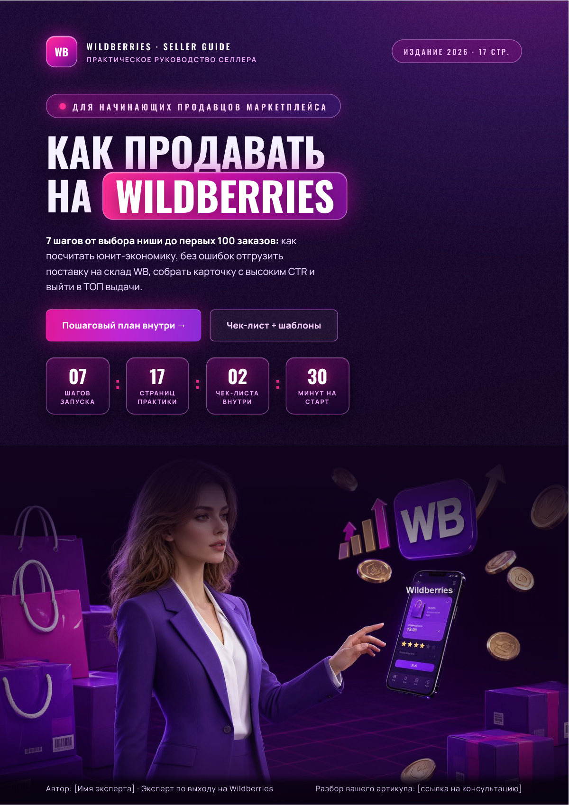

<div align="center">

# Wildberries: 7 шагов от нуля до продаж

**Гайд · 17 страниц · бесплатно**

[](https://Mary-RND.github.io/lead-magnet-wildberries/)
[](https://Mary-RND.github.io/lead-magnet-wildberries/download/wildberries-7-shagov.pdf)
[](https://Mary-RND.github.io/lead-magnet-wildberries/)

[Открыть страницу →](https://Mary-RND.github.io/lead-magnet-wildberries/) · [Скачать PDF](https://Mary-RND.github.io/lead-magnet-wildberries/download/wildberries-7-shagov.pdf) · [Заказать такой же](https://t.me/marypetrova6)

</div>



## О лид-магните

Выбор товара, юнит-экономика, первая поставка, карточка, фото, отзывы, трафик и аналитика — 17 страниц практики без «инфобизнесовых» обещаний.

Страница на GitHub Pages показывает **все 17 страниц** лид-магнита
скриншотами — можно пролистать перед скачиванием.

## Что в репозитории

```
index.html          — страница со всеми страницами PDF
screenshots/        — 17 превью в полном размере
download/wildberries-7-shagov.pdf
README.md
.nojekyll           — отключает Jekyll на GitHub Pages
```

## Заказать такой же

- **Стоимость:** 2 000 ₽ · **Срок:** 1 ч 00 мин
- Telegram: [@marypetrova6](https://t.me/marypetrova6)
- E-mail: [mar.petrushina@yandex.ru](mailto:mar.petrushina@yandex.ru)
- Портфолио: [mary-rnd.github.io/portfolio](https://mary-rnd.github.io/portfolio/)

---

© 2026 Марина Петрушина. Материалы можно использовать в личных целях;
перепродажа и публикация без согласия автора запрещены.
